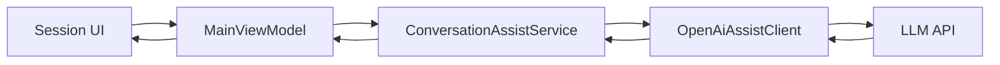

# LLM Session Pipeline Contract

## Purpose
Define a stable contract for how CuePilot invokes LLM generation for a selected session, so UI, orchestration, and API layers remain aligned as UX evolves.

## Scope
This contract covers:
- `What should I say` generation
- `Summary` generation behavior for selected session
- normal vs `Smart` reasoning modes
- mode-specific behavior (`Transcript`, `Summary`, `Screen`, overlay quick actions)
- request/response shape between ViewModel and orchestration layer
- error handling and security constraints

This contract does not define:
- final visual layout
- low-level DSP implementation details (exact filter coefficients and model internals)
- billing/quotas logic

## End-to-End Realtime Pipeline (Normative)
Canonical realtime path for transcript-driven features:

`Audio Input -> Normalization -> Noise Reduction -> VAD -> Chunking -> Acoustic Model (streaming) -> Decoder -> Beam Search + LM Rescoring -> Punctuation/Capitalization -> (optional) Diarization -> Text Normalization -> Session Store -> UI`

Normative latency/quality targets:
- pipeline SHOULD optimize for sub-second incremental updates in UI;
- quality SHOULD be measured by WER on a representative validation set;
- confidence scoring SHOULD be available at token or phrase level for low-confidence handling.

## Audio Transcription Optimization Contract
The implementation SHOULD follow these stages for speed and quality:

1) Signal preprocessing
- RMS loudness normalization for stable levels.
- Noise reduction via spectral subtraction, Wiener filter, or neural denoiser (for example RNNoise).
- Resampling to `16kHz` when target STT model is trained for this range.

2) Voice activity detection (VAD)
- Local VAD (`WebRTC VAD` or `Silero VAD`) MUST separate speech from silence.
- Non-speech intervals SHOULD be trimmed to reduce compute and latency.

3) Framing/chunking
- Recommended frame window: `20ms`; hop size: `10ms`.
- Streaming chunk inference MUST be enabled for near realtime output.

4) Acoustic model/runtime
- E2E model class MAY be `Whisper`, `Conformer`, `Wav2Vec2`, or equivalent.
- Quantization/pruning SHOULD be used where acceptable for CPU/GPU speedup.

5) Decoding and language modeling
- Beam search SHOULD use practical width (`5-10`) as default tradeoff.
- For CTC outputs, CTC-prefix beam search is preferred.
- Optional LM rescoring MAY be applied for final hypothesis quality.

6) Post-processing
- Punctuation and capitalization restoration SHOULD run before UI display/final summary.
- Text normalization MUST standardize numbers, dates, abbreviations according to locale rules.
- Spellcheck MAY be applied for offline/finalized text.

7) Optional diarization
- If speaker labels are required, diarization should run after VAD and before final output commit.

8) Compute optimizations
- GPU batching SHOULD group multiple segments when available.
- ONNX/TensorRT acceleration MAY be used when runtime supports it.
- The pipeline SHOULD be asynchronous with queue-based stages (VAD/ASR/LM/postprocess).

9) Domain adaptation
- Fine-tuning on target domain audio SHOULD be supported by roadmap.
- Bias lexicon / phrase list SHOULD be supported for proper nouns and technical terms.

## Mode Matrix Contract
Mode behavior MUST stay consistent between UI and orchestration.

### SmartMode
- Controlled by `SmartModeEnabled` in `AppSettings`.
- `true`: extended context-aware prompt template.
- `false`: minimal low-latency prompt template.
- Switching MUST apply without app restart.

### Transcript mode
- Uses full transcript of the selected session as primary context.
- If context exceeds token budget, retrieval/compression SHOULD select relevant chunks.
- If no relevant transcript data exists, return explicit "no data" style response.

### Summary mode
- Invoked by explicit summary generation action.
- MUST use normalized summary-ready transcript as input.
- MUST output structured markdown with required sections (for current product: Action Items + Conversation Highlights).

### Screen mode
- Uses screen/UI context (OCR + UI tree + active element) as primary source.
- If screen context is empty, fallback to transcript context is allowed.

### Overlay quick actions
- `What should I say`: short reply suggestion (2-3 sentences max).
- `Follow-up questions`: list of 3-5 clarifying questions, no answers.
- `Recap`: concise recap (target <= 70 words).

All quick actions MUST:
- use selected session context only;
- follow the same assist command pipeline as button/hotkey path;
- persist resulting assistant output to session usage/history.

## High-Level Flow

## Assist Command Pipeline
Canonical execution path for `Assist` actions (`What should I say`, follow-up generation, recap/summary regenerate):

`Assist Button/Hotkey`  
`-> UI Command/Click Handler`  
`-> MainViewModel command handler`  
`-> ConversationAssistService`  
`-> Load Active/Selected Session`  
`-> BuildTranscriptContext(session)`  
`-> Load model/runtime settings from AppSettings/JsonSettingsService`  
`-> Select prompt by SmartModeEnabled`  
`-> OpenAiAssistClient -> LLM API`  
`-> Validate + postprocess response`  
`-> Persist session fields via JsonSessionStore`  
`-> Update ViewModel state`  
`-> Render result in UI`

Normative rules:
- Button and hotkey MUST use the same handler path (no forked logic).
- Same session context, mode selection, and error handling MUST apply for both button and hotkey.
- UI MUST expose a busy/thinking state while generation is in progress.
- Concurrent conflicting generation for the same action SHOULD be blocked or debounced.
- Service MUST return controlled errors for missing/invalid model settings (`apiKey`, `model`, `baseUrl`) without crashing UI.

## Session Isolation Rules
All LLM calls MUST be scoped to the currently selected session only.

- Input context MUST come from `SelectedSession`.
- `Summary` and `Transcript` views MUST use data from the same session ID.
- Switching session MUST replace context for all subsequent calls.
- Cross-session context merge is forbidden.

## Transcript Preparation Contract
Before Summary generation, transcript MUST pass through layered normalization:

- `raw transcript`: original ASR text per source (`SYSTEM`/`MIC`)
- `cleaned transcript`: Unicode normalization (`FormKC`) + whitespace cleanup
- `formatted transcript`: stable `SPEAKER: text` lines
- `summary-ready transcript`: service prefixes removed, duplicate neighboring lines filtered

Only `summary-ready transcript` is allowed as Summary LLM input.

## Invocation Contract

### Call Site
Primary caller: `MainViewModel` command handler for `What should I say`.

### Required Inputs
- `sessionId`: selected session identifier
- `sessionTitle`: selected session title
- `transcriptWindow`: last N transcript lines from selected session (recommended 20)
- `userPrompt`: inline user prompt (if empty use default)
- `smartModeEnabled`: boolean toggle
- `modelSettings`:
  - `baseUrl`
  - `model`
  - `apiKey`

### Optional Inputs
- `summaryText` for the selected session (if already available)
- `usage metadata` (tokens/time budget) for adaptive behavior
- `screenContext` (OCR/UI tree/active element), when mode requires it

## Reasoning Modes

### Normal Mode
Goal: low latency tactical answer.

- short prompt template
- reduced context window
- minimal reasoning overhead
- expected output: one concise next phrase

### Smart Mode
Goal: higher quality answer with deeper analysis.

- extended prompt template
- richer context + explicit tone and relevance checks
- extra reasoning before final output
- expected output: one concise phrase, but with stronger consistency to context

## Output Contract

### Primary Output
`assistantReply` (string)

Rules:
- one practical next phrase
- same language as dominant session transcript
- no markdown formatting required
- no leakage of internal reasoning text to UI

### Secondary Metadata (optional)
- `modeUsed`: `normal` or `smart`
- `latencyMs`
- `promptTokens`, `completionTokens` (if available)

## Summary Contract
`Summary` MUST represent selected session only.

Priority:
1. persisted `session.summaryText` if explicitly finalized
2. generated bullet summary from that session transcript only
3. localized fallback text when transcript is empty

## Error Contract

### Failure Classes
- missing API key
- invalid key/auth
- timeout/network unavailable
- non-2xx provider response
- malformed response payload

### Required Behavior
- no silent failure
- return structured error to caller
- UI shows actionable message
- previous valid UI content remains intact when generation fails
- generation failure MUST NOT wipe existing transcript/summary content

## Security Contract
- API key MUST NOT be written to logs.
- API key MUST NOT appear in transcript/summary fields.
- API key MUST NOT be echoed in UI.
- request logs (if enabled) must redact secrets.

## Hotkey Integration Contract
Hotkeys trigger the same command path as UI buttons.

For `Ask` hotkey:
- invoke the same handler as `What should I say`
- reuse selected session context
- apply same mode and error behavior

## Persistence Contract
Persist through `AppSettings` + `JsonSettingsService`:
- `OpenAiApiKey`
- `OpenAiModel`
- `OpenAiBaseUrl`
- `SmartModeEnabled`

Session data persists through `JsonSessionStore`:
- transcript
- summary
- usage
- lifecycle state

## Recommended Validation Checklist
- Open session A, generate response, switch to session B, generate response: outputs differ by context.
- Smart OFF vs Smart ON produce distinct behavior (speed/quality tradeoff).
- Ask hotkey and button return equivalent results path.
- Missing key displays explicit error and does not crash.
- No secret appears in logs or UI.
- Transcript pipeline trims silence and still preserves semantic continuity.
- Summary output always contains required section structure.
- Overlay mode limits are enforced (`What should I say` length, follow-up count, recap length).
