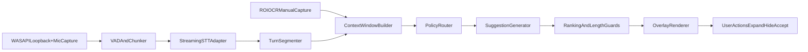

# CuePilot Technical Architecture v1 (Windows-first MVP)

## 1. System Overview
CuePilot is a local-first desktop copilot. The application captures local audio sources, transcribes speech in near real time, assembles short-lived context, generates ranked suggestions, and renders them in a low-latency overlay.

## 2. Architectural Layers
1. **Desktop Shell**
   - Window lifecycle, tray, onboarding, permissions, hotkeys.
   - Overlay states: hidden, mini, expanded, transcript drawer.
2. **Audio Capture**
   - WASAPI loopback for system audio.
   - Microphone input stream.
   - VAD preprocessing, buffering, source tagging.
3. **Speech Layer**
   - Streaming STT adapter with partial and final hypotheses.
   - Timestamped segments and confidence scores.
4. **Context Layer**
   - Turn segmentation and rolling context window.
   - Optional screen context ingestion (ROI OCR/manual capture).
5. **Reasoning Layer**
   - Policy router (cheap/fast vs richer reasoning route).
   - Suggestion generation and ranking.
   - Output schema and length guardrails.
6. **Privacy/Stealth Layer**
   - Capture-exclusion controls where supported.
   - Local session cache controls and redaction policy hooks.
7. **Sync/Backend Layer (minimal MVP)**
   - Feature flags, auth placeholder, telemetry sink interface.

## 3. Runtime Components (Windows-first)
- `apps/desktop` (Tauri + React/TS): UI shell and overlay.
- `desktop-core` (Rust modules):
  - `audio_engine`
  - `stt_gateway_client`
  - `context_engine`
  - `suggestion_router`
  - `stealth_manager`
- Optional local services:
  - `services/stt-gateway` (provider abstraction)
  - `services/orchestrator` (prompt/reasoning policy)

## 4. Event Flow


## 5. Core Contracts
### 5.1 Audio -> Speech
```ts
type AudioChunk = {
  source: "system" | "mic";
  sampleRate: number;
  channels: 1 | 2;
  timestampMs: number;
  pcm16: ArrayBuffer;
};
```

### 5.2 Speech -> Context
```ts
type TranscriptEvent = {
  sessionId: string;
  segmentId: string;
  isPartial: boolean;
  text: string;
  language: "ru" | "en" | "mixed";
  confidence?: number;
  sourceHint?: "system" | "mic" | "unknown";
  startMs: number;
  endMs: number;
};
```

### 5.3 Context -> Reasoning
```ts
type ContextPacket = {
  sessionId: string;
  mode: "meeting" | "sales" | "interview";
  recentTurns: Array<{ speaker: string; text: string; ts: number }>;
  screenContext?: { text: string; roiId: string; capturedAtMs: number };
  userIntentHints?: string[];
};
```

### 5.4 Reasoning -> Overlay
```ts
type SuggestionPayload = {
  primaryOneLiner: string;
  nextBestQuestion?: string;
  alternates?: string[];
  confidenceBand: "low" | "medium" | "high";
  expiresAtMs: number;
};
```

## 6. Latency Budget (MVP Targets)
- Audio capture + buffering: 50-120 ms
- VAD/chunking: 40-120 ms
- STT partial emission: 250-600 ms
- Context assembly: 20-80 ms
- Reasoning + ranking: 400-1400 ms
- Overlay render: < 50 ms

Total TTFS target:
- P50 <= 2.0s
- P95 <= 3.5s

## 7. Fallback Strategy
1. If system audio capture fails:
   - Continue with microphone-only mode.
   - Show explicit diagnostic and recovery steps.
2. If STT provider is unavailable:
   - Switch to backup provider (or degraded local model profile).
3. If reasoning times out:
   - Return template-based next-best-question.
4. If stealth mode unsupported:
   - Disable toggle and show compatibility warning.

## 8. State and Storage
### Local-Only by Default
- Ring buffers for live audio chunks (ephemeral).
- Rolling transcript window (N minutes, in-memory + optional encrypted local cache).
- Session-level settings profile.

### Optional Cloud (post-MVP path)
- User settings sync.
- Usage telemetry (non-PII by default).
- Model routing configs.

## 9. Security and Privacy Baseline
- Explicit permission gating for microphone/system capture features.
- No persistent raw audio storage in MVP default path.
- Session clear control: wipe local transcript/context cache.
- Redaction hook interface before any future upload.

## 10. Observability Baseline
- Structured logs with session and pipeline stage IDs.
- Metrics:
  - TTFS
  - transcript lag
  - suggestion generation latency
  - crash-free session rate
- Diagnostic panel for active devices and capture state.

## 11. Testing Strategy (Architecture Level)
- Unit tests for chunking, segmentation, and ranking guards.
- Integration tests for full speech->suggestion pipeline.
- Compatibility matrix tests for capture exclusion behavior.
- Fault injection tests:
  - device disconnect
  - STT timeout
  - reasoning timeout

## 12. Open Constraints (Tracked)
- Stealth behavior depends on OS/window manager and meeting app stack.
- Linux parity is out of MVP scope.
- macOS support starts after Windows alpha readiness checkpoint.
